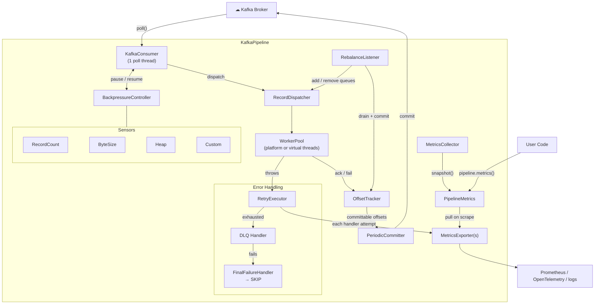

# kafka-pipeline

[](https://github.com/openlogiclab/kafka-pipeline/actions/workflows/gradle.yml)
[](https://codecov.io/gh/openlogiclab/kafka-pipeline)
[](https://central.sonatype.com/artifact/io.github.openlogiclab/kafka-pipeline)
[](https://opensource.org/licenses/Apache-2.0)

A lightweight Java library that wraps `KafkaConsumer` and handles the tedious parts — concurrent processing, backpressure, offset tracking, error handling — so you can focus on what matters: your record processing logic.

Zero additional dependencies beyond `kafka-clients` itself.

## Why

The Kafka consumer API is single-threaded by design. Scaling throughput means you're writing the same boilerplate every time: thread pools, partition-aware queuing, offset bookkeeping that doesn't lose data, graceful shutdown, rebalance handling, retry loops, dead letter queues...

This library packages all of that into a clean pipeline that you configure once and forget about. You give it a `RecordHandler`, pick your thread model, set your error policy, and it takes care of the rest.

## Design Guarantees

> **At-least-once delivery.** This library guarantees that every record is delivered to your handler at least once. It will **never** silently drop data. The tradeoff: duplicate delivery is possible after a crash (see [The Duplicate Processing Problem](#the-duplicate-processing-problem)). If you need exactly-once, implement idempotent processing in your handler.
>
> **Pausing under pressure, not dropping or blocking.** When internal queues fill up (misconfigured backpressure, unexpected burst, slow downstream), the affected partition is **paused** and the records that did not fit are fetched again later, rather than discarded. The poll thread itself never blocks, so heartbeats, rebalances and `stop()` keep working even when handlers are stuck. A rate-limited `WARNING` log is emitted when this happens — if you see it in production, tune your backpressure thresholds or concurrency. See [Tuning `dispatchQueueCapacity`](#tuning-dispatchqueuecapacity) for details.

## Installation

Replace `VERSION` with the latest release shown on the Maven Central badge above.

**Gradle (Kotlin DSL)**
```kotlin
implementation("io.github.openlogiclab:kafka-pipeline:VERSION")
```

**Gradle (Groovy)**
```groovy
implementation 'io.github.openlogiclab:kafka-pipeline:VERSION'
```

**Maven**
```xml
<dependency>
    <groupId>io.github.openlogiclab</groupId>
    <artifactId>kafka-pipeline</artifactId>
    <version>VERSION</version>
</dependency>
```

## Requirements

- **Java 21+** (virtual threads support)

## Getting Started

```java
Properties kafkaProps = new Properties();
kafkaProps.put("bootstrap.servers", "localhost:9092");
kafkaProps.put("group.id", "my-consumer-group");
kafkaProps.put("key.deserializer", "org.apache.kafka.common.serialization.StringDeserializer");
kafkaProps.put("value.deserializer", "org.apache.kafka.common.serialization.StringDeserializer");

KafkaPipeline<String, String> pipeline = new KafkaPipeline<>(
    KafkaPipeline.<String, String>builder()
        .consumerProperties(kafkaProps)
        .topic("orders")
        .handler(record -> orderService.process(record))
        .concurrency(ThreadMode.VIRTUAL, 200)
        .build());

pipeline.start();  // blocks until stop() is called or SIGTERM
```

That's it. 200 virtual threads processing records concurrently across all assigned partitions, with automatic offset commits, backpressure, and graceful shutdown out of the box.

## How It Works

```
KafkaConsumer.poll()              single-threaded, respects backpressure
       │
       ▼
RecordDispatcher                  per-partition bounded queues
       │
 ┌─────┼─────┐
 ▼     ▼     ▼
Worker Worker Worker              platform or virtual threads
       │
       ▼
OffsetTracker → PeriodicCommitter sliding-window offset tracking, async commits
```

### Architecture



**Solid arrows** = data / control flow. The main path reads top-to-bottom: poll → dispatch → process → track → commit.

1. A single poll loop fetches records and registers each offset with the tracker.
2. Records are dispatched to per-partition queues (partition ordering preserved within each queue).
3. Workers pull from queues and run your handler. Processing across partitions (and within a partition) is concurrent and unordered by default; see [Ordering](#ordering) to keep records of a key or partition in order.
4. As records complete, a sliding-window tracker figures out which offsets are safe to commit — only contiguous completed offsets advance the commit position, so you never skip over in-flight work.
5. A periodic committer pushes offsets to Kafka asynchronously, with a final sync commit on shutdown and rebalance.

## Data Flow

A concrete walkthrough of what happens to a single batch of records, from poll to commit.

### Happy Path

```
 Kafka Broker
     │
     │  poll() returns 5 records: offsets [10, 11, 12, 13, 14] on partition-0
     ▼
┌─────────────────────────────────────────────────────────────────────┐
│ Poll Loop (single thread)                                           │
│                                                                     │
│  for each record:                                                   │
│    1. offsetTracker.registerUnlessDone()   → state: REGISTERED      │
│       (skipped if it already finished before a restart)             │
│    2. inFlightCounter.registered()         → in-flight count +1     │
│    3. dispatcher.dispatch(tp, record)      → enqueue to partition-0 │
└─────────────────────────────────────────────────────────────────────┘
     │
     ▼
┌─────────────────────────────────────────────────────────────────────┐
│ RecordDispatcher                                                    │
│                                                                     │
│  partition-0 queue: [10, 11, 12, 13, 14]                            │
│  partition-1 queue: [...]                                           │
│                                                                     │
│  Workers parked via LockSupport get unparked on dispatch            │
└─────────────────────────────────────────────────────────────────────┘
     │
     ├──────────────┬──────────────┐
     ▼              ▼              ▼
┌──────────┐ ┌──────────┐ ┌──────────┐
│ Worker 1 │ │ Worker 2 │ │ Worker 3 │    (concurrent, unordered)
│ picks 10 │ │ picks 11 │ │ picks 12 │
└──────────┘ └──────────┘ └──────────┘
     │              │              │
     │   Each worker runs:
     │   1. offsetTracker.markInProgress(tp, offset)  → IN_PROGRESS
     │   2. hook.beforeProcess(record, ctx)            → skip if false
     │   3. handler.handle(record)                     → YOUR CODE
     │   4. hook.afterProcess(record, ctx)
     │   5. offsetTracker.ack(tp, offset)              → DONE
     │   6. inFlightCounter.completed()                → in-flight count -1
     │
     ▼
┌─────────────────────────────────────────────────────────────────────┐
│ OffsetTracker (UnorderedOffsetTracker / PartitionWindow)            │
│                                                                     │
│  Suppose workers finish in order: 10, 12, 11, 14, 13                │
│                                                                     │
│  After 10 completes:  committable = 11  (10 is done, contiguous)    │
│  After 12 completes:  committable = 11  (gap at 11)                 │
│  After 11 completes:  committable = 13  (10,11,12 contiguous now)   │
│  After 14 completes:  committable = 13  (gap at 13)                 │
│  After 13 completes:  committable = 15  (all done, 10–14 complete)  │
│                                                                     │
│  Key: committable offset = first_incomplete_offset                  │
│       (Kafka semantics: commit N = "start from N on next poll")     │
└─────────────────────────────────────────────────────────────────────┘
     │
     ▼
┌─────────────────────────────────────────────────────────────────────┐
│ PeriodicCommitter (every 5s by default)                             │
│                                                                     │
│  Reads committable offsets from tracker → commitAsync to Kafka      │
│  On shutdown/rebalance → commitSync (blocking, guaranteed)          │
└─────────────────────────────────────────────────────────────────────┘
```

### Error Path

When `handler.handle()` throws:

```
handler.handle(record) throws
     │
     ▼
Retry loop (attempt 1, 2, ... maxRetries)
  backoff: retryBackoff (default 1s); doubles up to maxBackoff with exponentialBackoff(true)
  an attempt past processingTimeout (if set) is interrupted and counts as a failure
  hook.onError() called on each failure
     │
     ├── retry succeeds → ack, done                       (recordsProcessed)
     │
     ▼  all retries exhausted
DLQ handler (if configured)
     │
     ├── DLQ send succeeds → ack, done                    (dlqSuccesses)
     │
     ▼  DLQ fails or not configured
FinalFailureHandler (log, file, alert, etc.)
     │
     └── SKIP → ack anyway, move on                       (recordsFailed)
```

### Rebalance Flow

When Kafka triggers a consumer group rebalance:

```
onPartitionsRevoked([partition-0, partition-2])
     │
     ▼
  1. dispatcher.removePartition(tp)
     → clear queued records, adjust sensor count
     
  2. offsetTracker.drainPartition(tp, drainTimeout)
     → wait for in-flight workers to finish (up to 30s default),
       all revoked partitions in parallel
     → returns: {completed: 47, abandoned: 2, timedOut: true/false}
     
  3. committer.commitSync()
     → final offset commit for revoked partitions
     
  4. offsetTracker.clearPartition(tp)
     → remove all state for this partition

onPartitionsAssigned([partition-0, partition-5])
     │
     ▼
  1. consumer.position(tp) → get starting offset from Kafka
  2. offsetTracker.initPartition(tp, startOffset)
  3. dispatcher.addPartition(tp) → create fresh queue
  4. poll loop resumes → records flow into the new partitions
```

### Backpressure Flow

```
Poll loop evaluates all sensors before each poll:

  BackpressureController.evaluate():
    for each sensor in [record-count, byte-size, heap, ...custom]:
      status = sensor.currentStatus()
      worst  = max(worst, status)

  Record-count sensor:
    in-flight < highWatermark           → OK
    in-flight >= highWatermark          → THROTTLE
    in-flight >= criticalThreshold      → CRITICAL

  Byte-size sensor (if enabled):
    inFlightBytes < highWatermarkBytes  → OK
    inFlightBytes >= highWatermarkBytes → THROTTLE
    inFlightBytes >= criticalBytes      → CRITICAL

  Heap sensor (if enabled):
    heapUsed/heapMax < throttleThreshold  → OK
    heapUsed/heapMax >= throttleThreshold → THROTTLE
    heapUsed/heapMax >= criticalThreshold → CRITICAL

  Action based on worst status:
    OK       → poll normally
    THROTTLE → consumer.pause(assignment)  → heartbeats only
    CRITICAL → consumer.pause(assignment)  → heartbeats only

  Once paused, workers keep draining...
    
  When ALL sensors return OK           → consumer.resume(assignment)
  (each sensor has its own low/resume watermark hysteresis)
```

The high/low watermark gap is the hysteresis band. Without it, the consumer would thrash between pause and resume on every single record completing near the threshold.

## Configuration

### One topic per pipeline

Use `.topic("orders")` and run one `KafkaPipeline` per topic, each with its own `group.id`. Everything inside a pipeline is shared: the worker thread pool, the global backpressure watermarks and the consumer. If one pipeline serves two topics, a slow topic can occupy every worker and its backpressure pauses the other topic too.

```java
ordersProps.put("group.id", "svc-orders");
paymentsProps.put("group.id", "svc-payments");

KafkaPipeline<String, String> orders = new KafkaPipeline<>(
    KafkaPipeline.<String, String>builder()
        .consumerProperties(ordersProps)
        .topic("orders")
        .handler(record -> orderService.process(record))
        .concurrency(ThreadMode.VIRTUAL, 200)
        .build());

KafkaPipeline<String, String> payments = new KafkaPipeline<>(
    KafkaPipeline.<String, String>builder()
        .consumerProperties(paymentsProps)
        .topic("payments")
        .handler(record -> paymentService.process(record))
        .concurrency(ThreadMode.VIRTUAL, 50)
        .build());

orders.startAsync();
payments.startAsync();
```

`.topics("orders-us", "orders-eu")` is still available for topics that are really the same workload (same handler, similar volume and latency), such as regional shards.

### Thread Model

Two options, set explicitly when you configure concurrency:

```java
// Fixed pool of OS threads — good for CPU-bound work
.concurrency(ThreadMode.PLATFORM, 16)

// Virtual threads (JDK 21+) — good for I/O-bound work (DB, HTTP, etc.)
.concurrency(ThreadMode.VIRTUAL, 500)
```

> **Virtual threads on Java 21–23: watch out for pinning.** A virtual thread that blocks inside a `synchronized` block or method (for example a JDBC driver, an HTTP client, or your own code doing I/O while holding a monitor) *pins* its carrier OS thread. There are only as many carriers as CPU cores by default, so a few pinned handlers can stall every other virtual thread, including ones that would release the lock — which looks like a deadlock. Options: run on Java 24+ (JEP 491 removes this pinning), replace `synchronized` around blocking calls with `ReentrantLock`, or use `ThreadMode.PLATFORM`. Run with `-Djdk.tracePinnedThreads=short` to find pinning sites. The library's own worker code does not hold monitors while calling your handler.

### Noisy partitions

All partitions in a pipeline share one worker pool. If one partition's records are slow (a slow downstream, a hot key), it can end up holding every worker while records of other partitions wait. Cap how many workers one partition may use:

```java
.concurrency(ThreadMode.VIRTUAL, 200)
.maxConcurrencyPerPartition(20)   // ~2 × 200 workers / 20 partitions
```

A worker skips a partition that is already at its limit and takes the next partition with work, so the cap costs nothing while traffic is spread evenly.

The limit never drops below a fair share of the pool: the enforced value is `max(n, ⌈concurrency ÷ assigned partitions⌉)`, recomputed on every rebalance. With `concurrency(200)` and `maxConcurrencyPerPartition(20)`:

| Partitions assigned to this instance | Enforced limit |
|---|---|
| 1 | 200 (the whole pool) |
| 4 | 50 |
| 20 or more | 20 |

So a pod that ends up with a single partition still uses every worker, and the cap only bites once there are enough partitions to compete. In batch mode the same limit caps how many batches of one partition are processed at once.

### Ordering

By default records are processed concurrently in any order, even within a partition. When order matters, choose a `ProcessingOrder`:

```java
.ordering(ProcessingOrder.KEY)
```

| Mode | Guarantee | Parallelism |
|---|---|---|
| `UNORDERED` (default) | None | Every worker on any record |
| `KEY` | Records with the same key run one at a time, in offset order | Across keys, even within one partition |
| `PARTITION` | Records of a partition run one at a time, in offset order | One worker per partition |

`KEY` gives the guarantee most services need (all events of one order, account or device in sequence) while still running different keys of a hot partition in parallel. Records with a `null` key have no key to order by and run unordered. `byte[]` keys are compared by content.

In both ordered modes a record that fails and is retried keeps its key (or partition) blocked until it finishes, is sent to the DLQ, or falls back, so a later record never overtakes it. A slow key only holds back records of that key; the poll thread keeps fetching and other keys keep running until the partition's window fills (see [Sliding Window](#sliding-window)).

In batch mode, `KEY` and `PARTITION` both mean one batch per partition in flight at a time: the next batch of a partition is fetched again once the previous one finishes.

Ordering applies within this consumer. If a partition is revoked while a record is still running (past `drainTimeout`) and then assigned back to this same consumer, the redelivered records of that key (or partition, in `PARTITION` mode) wait for it to finish. A partition that moves to another consumer cannot be fenced that way: a record still running here can overlap with its redelivery there. Across a rebalance or restart, records after the committed offset are redelivered to the new owner, so a key's records can run again in order there (see [The Duplicate Processing Problem](#the-duplicate-processing-problem)).

### Error Handling

The pipeline supports two error handling strategies via `Fallback`:

| Option | Behavior |
|--------|----------|
| `Fallback.SKIP` | Direct skip — no DLQ, skip failed records immediately |
| `Fallback.DLQ_THEN_SKIP` | Try DLQ first, skip if DLQ also fails |

```java
.errorStrategy(ErrorStrategy.<String, String>builder()
    .maxRetries(3)
    .retryBackoff(Duration.ofSeconds(1))
    .exponentialBackoff(true)
    .maxBackoff(Duration.ofSeconds(30))
    .dlqHandler((record, error) -> dlqProducer.send(toDlqRecord(record, error)))
    .fallback(Fallback.DLQ_THEN_SKIP)  // try DLQ, skip if fails
    .onFinalFailure((record, error) -> log.error("Unrecoverable: {}", record.offset(), error))
    .build())
```

The `FinalFailureHandler` is the **final preservation** mechanism — invoked only when all retries AND DLQ fail. After it returns, the record is **permanently dropped** and the offset is committed.

**Trade-off:** The system prioritizes throughput over blocking on unprocessable data. Records that cannot be processed (after retries and DLQ) are skipped, and the offset advances immediately so the pipeline keeps moving. If `FinalFailureHandler` doesn't preserve the data, it's lost forever. The default handler only logs metadata — implement your own to save raw data (PVC, S3, database) if preservation is critical.

For simple cases there are factory methods:

```java
ErrorStrategy.skipOnError()          // Fallback.SKIP — no retries, skip immediately (the default)
ErrorStrategy.withDlq(dlqHandler, 3) // Fallback.DLQ_THEN_SKIP — 3 retries, then DLQ, then skip
```

#### Processing timeout

A handler that hangs (a stuck HTTP call, a lock that never frees) holds its worker and keeps its partition from committing. Bound each attempt:

```java
.processingTimeout(Duration.ofSeconds(30))
```

Off by default. An attempt that runs longer is interrupted and counts as a failure, so it goes through the same retry → DLQ → skip chain. An attempt that finishes after the deadline anyway is treated as processed. A handler that ignores interrupts (a busy loop, some blocking I/O) cannot be stopped; it keeps its worker until it returns. Pick the value from `metrics().handlerDuration()`, and watch `processingTimeouts` to see how often it fires.

### Batch Mode

For high-throughput scenarios where per-record overhead matters — bulk inserts, file aggregation, batched API calls — use `batchHandler` instead of `handler`. Records from each partition are delivered as a single batch, and offset tracking uses one lock acquisition per batch instead of per record.

```java
KafkaPipeline<String, String> pipeline = new KafkaPipeline<>(
    KafkaPipeline.<String, String>builder()
        .consumerProperties(kafkaProps)
        .topic("events")
        .batchHandler((partition, records) -> {
            bulkInsert(records);
        })
        .concurrency(ThreadMode.VIRTUAL, 50)
        .build());
```

Batch mode uses the same error chain (retry → DLQ → fallback), but applied to the entire batch. The sliding window still tracks out-of-order batch completion correctly — if batch A finishes before batch B, the commit offset won't advance past batch B's range until it completes.

You must use either `handler` (per-record) or `batchHandler` (batch), not both.

### Backpressure

The pipeline supports multiple backpressure layers that work together. The poll loop checks all active sensors and applies the worst status.

#### Record-Count Backpressure

Enabled by default. Uses high/low watermark hysteresis to prevent pause/resume flapping:

```java
.backpressure(BackpressureConfig.builder()
    .highWatermark(10_000)     // pause polling when in-flight records reach this
    .lowWatermark(6_000)       // resume polling when count drops to this
    .criticalThreshold(50_000) // report CRITICAL instead of THROTTLE
    .build())
```

THROTTLE and CRITICAL both pause the consumer; CRITICAL is the stronger signal, reported by `metrics().backpressureStatus()` so a health check can tell "busy" from "in trouble" (see [Metrics](#metrics)).

#### Byte-Level Backpressure

Protects against memory pressure when individual records are large (e.g. 10 MB file payloads). Tracks total in-flight payload bytes using `ConsumerRecord.serializedKeySize() + serializedValueSize()`. Disabled by default — opt in with:

```java
.byteBackpressure(ByteBackpressureConfig.builder()
    .lowWatermarkBytes(128 * 1024 * 1024)     // 128 MB — resume
    .highWatermarkBytes(256 * 1024 * 1024)    // 256 MB — pause
    .criticalThresholdBytes(512 * 1024 * 1024) // 512 MB — report CRITICAL
    .build())
```

#### Heap Backpressure

Monitors overall JVM heap usage via `MemoryMXBean` and pauses the consumer when the heap gets too full — regardless of whether the pressure comes from in-flight records, producer buffers, caches, or anything else. This is especially useful for Kafka-to-Kafka forwarding pipelines where `producer.send()` buffers large amounts of data in flight. Disabled by default — opt in with:

```java
.heapBackpressure(HeapBackpressureConfig.builder()
    .resumeThreshold(0.5)     // resume polling at 50% heap usage
    .throttleThreshold(0.7)   // pause polling at 70% heap usage
    .criticalThreshold(0.9)   // report CRITICAL at 90% heap usage
    .build())
```

Thresholds are ratios (0.0–1.0) of `heapUsed / heapMax` (your `-Xmx` or `-XX:MaxRAMPercentage`). The same hysteresis logic applies — once throttled at 70%, the consumer stays paused until usage drops back to 50%.

Unlike record-count and byte-level sensors which only track the pipeline's own in-flight data, the heap sensor captures **all** JVM memory pressure. This makes it a good safety net when your handler allocates significant memory beyond the records themselves.

#### Built-in Sensor Summary

| Sensor | Enabled by default | What it tracks | When to use |
|---|---|---|---|
| Record-count | Yes | Number of in-flight records | Always — general-purpose flow control |
| Byte-level | No | Payload bytes of in-flight records | Large/variable record sizes |
| Heap | No | JVM heap usage (`used/max`) | Producer buffering, caches, or any heap-heavy workload |

All active sensors run in parallel. The poll loop checks every sensor on each cycle and applies the worst status — if any single sensor says THROTTLE, the consumer pauses until **all** sensors return OK.

#### Custom Backpressure Sensors

You can plug in your own sensors for domain-specific pressure signals — external queue depth, downstream service health, or anything else:

```java
.addBackpressureSensor(new BackpressureSensor() {
    @Override
    public BackpressureStatus currentStatus() {
        if (downstreamService.isOverloaded()) return BackpressureStatus.CRITICAL;
        if (downstreamService.queueDepth() > 10_000) return BackpressureStatus.THROTTLE;
        return BackpressureStatus.OK;
    }

    @Override
    public String name() { return "downstream-health"; }

    @Override
    public String statusDetail() { return "queue depth: " + downstreamService.queueDepth(); }
})
```

Custom sensors are evaluated alongside the built-in ones — the worst status across all of them determines whether the consumer pauses.

When backpressure kicks in, the consumer is paused (not disconnected) — it stays in the group and responds to heartbeats, but stops fetching new records until workers catch up.

### Lifecycle Hooks

For cross-cutting concerns — deduplication, tracing, audit logging — without cluttering your handler. (For metrics, use a [metrics exporter](#exporting-metrics) instead.)

```java
.lifecycleHook(new ProcessingLifecycleHook<>() {
    @Override
    public boolean beforeProcess(ConsumerRecord<String, String> record, ProcessingContext ctx) {
        // Return false to skip (e.g., dedup check)
        return !dedupStore.exists(ctx.topic(), ctx.partition(), ctx.offset());
    }

    @Override
    public void afterProcess(ConsumerRecord<String, String> record, ProcessingContext ctx) {
        dedupStore.mark(ctx.topic(), ctx.partition(), ctx.offset());
    }

    @Override
    public void onError(ConsumerRecord<String, String> record, ProcessingContext ctx, Exception error) {
        log.warn("Attempt {} failed for {}-{}@{}", ctx.attempt(), ctx.topic(), ctx.partition(), ctx.offset(), error);
    }
})
```

`beforeProcess` returning `false` is the idempotency hook — the record gets acked without touching your handler.

### Metrics

The pipeline collects operational metrics internally: throughput, record outcomes, handler time, backpressure, retries, commits, rebalances and per-partition state. There are two ways to read them:

- **`pipeline.metrics()`** returns a snapshot on demand, for logs, health checks and tests.
- **A [metrics exporter](#exporting-metrics)** publishes them to your monitoring system (Prometheus, OpenTelemetry, ...).

The core has no metrics dependencies and runs no background threads for this.

```java
PipelineMetrics m = pipeline.metrics();

m.recordsProcessed();                       // handler succeeded
m.recordsFailed();                          // dropped after retries and DLQ: data loss
m.inFlightRecords();
m.backpressureStatus();
m.handlerDuration().mean();
m.partitions().get(tp).commitStallMillis(); // how long this partition's commits are stuck
```

`PipelineMetrics` and the other metrics types live in `io.github.openlogiclab.kafkapipeline.metrics`. A snapshot is immutable and safe to pass across threads or log. The types are sealed interfaces: you read them, only the pipeline creates them, so new metrics can be added in later releases without breaking your code.

#### Counter vs. Gauge

- **Counters** (`recordsProcessed`, `retryAttempts`, `commitSuccesses`, ...) are cumulative totals since pipeline start. Compute rates by diffing two snapshots:
  ```java
  long rate = (current.recordsProcessed() - previous.recordsProcessed()) / elapsedSeconds;
  ```
- **Gauges** (`inFlightRecords`, `inFlightBytes`, `backpressureStatus`, the per-partition values) are instantaneous values that go up and down.

#### Record outcomes

Every record the pipeline finishes is counted in exactly one outcome, so the four add up to the total:

| Outcome | Counter |
|---|---|
| Handler succeeded (possibly after retries) | `recordsProcessed` |
| Skipped by the lifecycle hook (`beforeProcess` returned `false`) | `recordsSkipped` |
| Sent to the DLQ | `dlqSuccesses` |
| Dropped: retries failed, and no DLQ or the DLQ send failed | `recordsFailed` |

Records left unfinished by a shutdown or rebalance are in none of them; they are redelivered (`recordsAbandoned`). Alert on `recordsFailed`: it is data loss.

#### Available Metrics

| Category | Metric | Type | Description |
|---|---|---|---|
| Identity | `name` | — | Pipeline name (`name(...)`, default `group.id`) |
| Throughput | `recordsProcessed` | Counter | Records whose handler succeeded |
| | `recordsSkipped` | Counter | Records skipped by the lifecycle hook |
| | `recordsFailed` | Counter | Records dropped after retries and DLQ failed |
| | `handlerDuration` | Counter | Count and total time of handler attempts (`count()`, `total()`, `mean()`); retries, failed and timed-out attempts included, a batch call counts once |
| | `pollCount` | Counter | Total `consumer.poll()` calls |
| | `emptyPollCount` | Counter | Polls that returned zero records |
| Pressure | `inFlightRecords` | Gauge | Records between poll and ack |
| | `inFlightBytes` | Gauge | Estimated bytes of in-flight records |
| | `backpressureStatus` | Gauge | Current backpressure level (OK / THROTTLE / CRITICAL) |
| | `throttleCount` | Counter | Times backpressure activated |
| Errors | `retryAttempts` | Counter | Retry attempts across all records |
| | `processingTimeouts` | Counter | Attempts interrupted by `processingTimeout` |
| | `dlqSuccesses` | Counter | Records sent to the DLQ |
| | `dlqFailures` | Counter | Records whose DLQ send failed |
| | `finalFailures` | Counter | `FinalFailureHandler` calls, one per dropped record |
| | `commitSuccesses` | Counter | Successful offset commits |
| | `commitFailures` | Counter | Failed offset commits |
| Rebalance | `rebalanceCount` | Counter | Consumer group rebalances |
| | `drainTimeouts` | Counter | Drains that didn't finish within `drainTimeout` |
| | `recordsAbandoned` | Counter | Records abandoned during rebalance, redelivered to the new owner |
| | `assignedPartitions` | Gauge | Currently assigned partitions |

`partitions()` has an entry for **every** assigned partition, idle ones included, so each partition always reports a value:

| Metric | Type | Description |
|---|---|---|
| `lag` | Gauge | Records polled but not yet committable |
| `failures` | Counter | Dropped records on this partition since it was assigned |
| `commitStallMillis` | Gauge | How long the committable offset hasn't moved while records wait; growing means a stuck record at the head |
| `windowSize` / `windowCapacity` | Gauge | Entries in the partition's offset window, and its limit (`maxWindowSize`) |
| `windowFill` | Gauge | `windowSize / windowCapacity`; near 0.8 the partition is about to pause — an earlier warning than lag |

#### Exporting metrics

Register one or more exporters on the builder:

```java
KafkaPipeline.<String, String>builder()
    // ...
    .metricsExporter(new MicrometerExporter(meterRegistry))
    .build();
```

An exporter implements `MetricsExporter`. When the pipeline starts, it calls `bind` with a `MetricsBinding` that offers two things:

- **Pull:** `snapshot()` for counters and gauges. Read it whenever your monitoring system collects; it is cheap and thread-safe.
- **Push:** `onHandlerAttempt(listener)` delivers every handler attempt (partition, duration, outcome `SUCCESS` / `FAILURE` / `TIMEOUT`). Use it for histograms and percentiles, which a snapshot cannot carry.

A minimal Micrometer exporter:

```java
import io.github.openlogiclab.kafkapipeline.metrics.AttemptOutcome;
import io.github.openlogiclab.kafkapipeline.metrics.MetricsBinding;
import io.github.openlogiclab.kafkapipeline.metrics.MetricsExporter;
import io.micrometer.core.instrument.*;  // Timer is Micrometer's, not java.util.Timer
import java.util.ArrayList;
import java.util.EnumMap;
import java.util.List;
import java.util.Map;
import java.util.concurrent.TimeUnit;

public final class MicrometerExporter implements MetricsExporter {
    private final MeterRegistry registry;
    private final List<Meter> meters = new ArrayList<>();

    public MicrometerExporter(MeterRegistry registry) { this.registry = registry; }

    @Override
    public void bind(MetricsBinding binding) {
        Tags tags = Tags.of("pipeline", binding.pipelineName());

        // Pull: read on every scrape.
        meters.add(FunctionCounter.builder("kafka.pipeline.records.processed", binding,
                b -> b.snapshot().recordsProcessed()).tags(tags).register(registry));
        meters.add(FunctionCounter.builder("kafka.pipeline.records.failed", binding,
                b -> b.snapshot().recordsFailed()).tags(tags).register(registry));
        meters.add(Gauge.builder("kafka.pipeline.in.flight.records", binding,
                b -> b.snapshot().inFlightRecords()).tags(tags).register(registry));

        // Push: one timer per outcome, recorded on every attempt, with percentiles.
        Map<AttemptOutcome, Timer> timers = new EnumMap<>(AttemptOutcome.class);
        for (AttemptOutcome outcome : AttemptOutcome.values()) {
            Timer timer = Timer.builder("kafka.pipeline.handler.duration")
                    .tags(tags).tag("outcome", outcome.name().toLowerCase())
                    .publishPercentileHistogram()
                    .register(registry);
            timers.put(outcome, timer);
            meters.add(timer);
        }
        binding.onHandlerAttempt(a ->
                timers.get(a.outcome()).record(a.durationNanos(), TimeUnit.NANOSECONDS));
    }

    @Override
    public void close() { meters.forEach(registry::remove); }
}
```

What the pipeline guarantees, and what to keep in mind when writing one:

- **Lifecycle.** `bind` runs in `start()`, so an exporter that throws there fails `start()`, like any other setup error. `close` runs once at the end of shutdown, after the final commit, so the last values are published. Exporters are closed in reverse order.
- **Isolation.** After `bind`, a failing exporter never affects processing. An exception from a listener or from `close` is logged (WARNING once, then DEBUG) and ignored.
- **Listeners run on the worker thread**, right after each attempt. Record into a histogram and return; don't block.
- **Per-partition series.** Partitions come and go with rebalances: register a series when a partition appears in `snapshot().partitions()` and remove it when it disappears.
- **Several pipelines.** An exporter registered with several pipelines is bound once per pipeline; tag by `pipelineName()`.
- **Snapshot cost.** `snapshot()` builds the per-partition map on every call. With many pull meters, cache it for the duration of one scrape.

For a quick look without an exporter, log the snapshot periodically:

```java
scheduler.scheduleAtFixedRate(() -> logger.info("pipeline: {}", pipeline.metrics()), 0, 30, TimeUnit.SECONDS);
```

Or use it in a health check:

```java
app.get("/health", ctx ->
    ctx.status(pipeline.metrics().backpressureStatus() == BackpressureStatus.CRITICAL ? 503 : 200));
```

#### Diagnostic Quick Reference

| Symptom | Check | Likely Cause |
|---|---|---|
| Throughput drops to zero | `backpressureStatus`, `inFlightRecords` | Backpressure triggered — workers slower than poll rate |
| Consumer lag growing | `partitions()` → `lag`, `retryAttempts` | Retry storms or slow handler |
| One partition stops committing | `partitions()` → `commitStallMillis`, `windowFill` | A stuck record at the head of the partition; consider `processingTimeout` |
| Handlers slow or timing out | `handlerDuration().mean()`, `processingTimeouts` | Slow downstream, or `processingTimeout` too close to normal handler time |
| Frequent rebalances | `rebalanceCount`, `drainTimeouts` | Pods restarting or scaling without static membership, or `session.timeout.ms` too low (see [Running in Production](#running-in-production)) |
| Data loss suspected | `recordsFailed`, `dlqFailures` | Records dropped after retries; check the DLQ and the final failure logs |
| Memory pressure | `inFlightRecords`, `inFlightBytes` | Backpressure thresholds too high |

### Async Start

If you don't want to block the main thread:

```java
KafkaPipeline<String, String> pipeline = new KafkaPipeline<>(config);
Thread t = pipeline.startAsync();

// ... do other stuff ...

pipeline.stop();
pipeline.awaitShutdown();
```

### All Config Options

| Option | Default | Description |
|---|---|---|
| `consumerProperties` | *required* | Standard Kafka consumer properties (`enable.auto.commit` is forced to `false`) |
| `topic` / `topics` | *required* | Topic to subscribe to; one per pipeline is recommended (see [One topic per pipeline](#one-topic-per-pipeline)) |
| `handler` | *one required* | Your `RecordHandler<K,V>` for per-record mode |
| `batchHandler` | *one required* | Your `BatchRecordHandler<K,V>` for batch mode |
| `concurrency(ThreadMode, int)` | *required* | Thread model and worker count |
| `backpressure` | high=10k, low=6k, critical=50k | Record-count watermarks |
| `byteBackpressure` | disabled | Byte-level watermarks for memory protection |
| `heapBackpressure` | disabled | JVM heap usage watermarks (via `MemoryMXBean`) |
| `addBackpressureSensor` | none | Custom backpressure sensor(s) |
| `errorStrategy` | `skipOnError()` | Retry + DLQ + fallback chain; the default retries nothing and skips, logging the record's metadata (see [Error Handling](#error-handling)) |
| `processingTimeout` | 0 (off) | Max duration of one handler attempt before it is interrupted and counted as failed (see [Processing timeout](#processing-timeout)) |
| `lifecycleHook` | no-op | Before/after/error callbacks (per-record mode only) |
| `commitInterval` | 5s | How often to commit offsets async |
| `drainTimeout` | 30s | Max wait for in-flight records during rebalance |
| `shutdownTimeout` | 30s | Max wait for records already being processed to finish on shutdown; queued records that haven't started are redelivered on the next start |
| `pollTimeout` | 100ms | Kafka consumer poll timeout |
| `dispatchQueueCapacity` | 500 | Bounded queue capacity for pending work (see below) |
| `maxConcurrencyPerPartition` | 0 (unlimited) | Max records (batches, in batch mode) of one partition processed at once, so a slow partition can't take every worker (see [Noisy partitions](#noisy-partitions)) |
| `maxWindowSize` | 10,000 | Max tracked offsets per partition; the partition pauses at 80% and resumes at 50%. Must be ≥ `max.poll.records` (see [Sliding Window](#sliding-window)) |
| `ordering` | `UNORDERED` | `KEY` or `PARTITION` to keep records in order (see [Ordering](#ordering)) |
| `skipCompletedOnRestart` | `true` | Record finished offsets past the committed one in commit metadata and skip them on the next assignment (see [The Duplicate Processing Problem](#the-duplicate-processing-problem)) |
| `name` | `group.id` | Identifies the pipeline in metrics, e.g. as a tag when several run in one JVM |
| `metricsExporter` | none | Exporter(s) that publish metrics to your monitoring system; call once per exporter (see [Exporting metrics](#exporting-metrics)) |

### Tuning `dispatchQueueCapacity`

This controls how much pending work can queue up between the poll loop and worker threads:

- **Per-record mode** — capacity of each per-partition dispatch queue.
- **Batch mode** — capacity of the executor's task queue (PLATFORM threads only; virtual threads create a lightweight thread per task and don't queue).

The default is **500**, matching Kafka's default `max.poll.records`. A good rule of thumb: set it to your `max.poll.records` value.

```java
// If you set max.poll.records=1000, match it:
kafkaProps.put("max.poll.records", "1000");

KafkaPipeline.<String, String>builder()
    .consumerProperties(kafkaProps)
    .topic("events")
    .handler(record -> process(record))
    .concurrency(ThreadMode.VIRTUAL, 200)
    .dispatchQueueCapacity(1000)
    .build();
```

When the queue fills up, the poll thread does **not** block. Records that don't fit stay unacknowledged, the consumer seeks back to the first of them and pauses that partition; other partitions keep flowing. The partition resumes once its queue has drained to half capacity, and the skipped records are fetched again — nothing is dropped. You'll see a rate-limited `WARNING` log if this happens:

```
WARNING: Dispatch queue full for topic-0, pausing the partition until workers catch up
         (N times since last warning) — consider more concurrency or a larger dispatchQueueCapacity
```

Because the poll thread keeps running, heartbeats, rebalances and `stop()` are unaffected even if every handler is stuck.

> **Warning:** If you see this message in production, it typically means backpressure thresholds are set too high relative to processing speed, or `dispatchQueueCapacity` is too low. Fix the root cause — don't just increase the queue capacity, as oversized queues waste memory and reduce backpressure sensitivity (records sit idle in the queue longer before backpressure kicks in).

A full example tying `dispatchQueueCapacity`, `max.poll.records`, and backpressure together:

```java
// max.poll.records = 500 (default)
// backpressure highWatermark = 2000  (pause after ~4 polls worth in-flight)
// dispatchQueueCapacity = 500        (one poll's worth per partition queue)

KafkaPipeline.<String, String>builder()
    .consumerProperties(kafkaProps)
    .topic("orders")
    .handler(record -> orderService.process(record))
    .concurrency(ThreadMode.VIRTUAL, 100)
    .backpressure(BackpressureConfig.builder()
        .highWatermark(2000)
        .lowWatermark(1000)
        .criticalThreshold(10_000)
        .build())
    .dispatchQueueCapacity(500)
    .build();
```

In this setup, backpressure pauses the poll loop well before the dispatch queue fills up. The queue-full pause only kicks in as a last resort if something unexpected happens at runtime.

## Running in Production

### Kafka consumer settings

Pass these through `consumerProperties`:

```java
// Only partitions that actually move are revoked during a rebalance; the rest keep processing.
kafkaProps.put("partition.assignment.strategy",
    "org.apache.kafka.clients.consumer.CooperativeStickyAssignor");

// Static membership: a restarting pod rejoins with the same identity and keeps its partitions,
// so a rolling deploy does not trigger a rebalance per pod. Must be unique and stable per
// instance, e.g. the StatefulSet pod name exposed through the Kubernetes downward API.
kafkaProps.put("group.instance.id", System.getenv("POD_NAME"));
kafkaProps.put("session.timeout.ms", "45000"); // longer than a pod restart takes
```

If your brokers set `offset.metadata.max.bytes` below the default 4096, raise it to at least 4096. Otherwise the first commit whose metadata is too large is rejected; the pipeline then logs a warning, stops recording finished offsets, and commits plain offsets from then on.

`max.poll.interval.ms` does not need to cover handler time. The poll thread keeps calling `poll()` while records are processed, and pauses partitions instead of blocking when queues or windows fill up. It only has to cover `drainTimeout` (default 30s), which runs inside `poll()` during a rebalance.

### Scaling

- **Partitions cap parallelism across pods.** Each partition belongs to one pod in the group, so pods beyond the partition count sit idle. Create topics with headroom (for example 2–4× the most pods you expect); adding partitions later changes which partition each key maps to.
- **Scale on consumer lag, not CPU.** I/O-bound handlers keep CPU low while lag grows. KEDA's Kafka scaler can scale a Deployment on lag directly.
- **Get more out of each pod first.** `ThreadMode.VIRTUAL` and batch mode with bulk writes downstream usually raise throughput per pod more cheaply than adding pods.
- **One pipeline per workload.** See [One topic per pipeline](#one-topic-per-pipeline) and [Noisy partitions](#noisy-partitions).

### Kubernetes CPU limits

The JVM sizes itself from the container's CPU limit: the number of carrier threads that run virtual threads, GC threads and `availableProcessors()` all follow it. With a limit of `1` or less (e.g. `500m`), every virtual thread shares a single carrier, and CFS throttling adds latency spikes.

- Give pods at least 2 CPUs, or set the processor count explicitly with `-XX:ActiveProcessorCount=N`.
- Pinning threads to cores (CPU affinity) is not supported. Containers with CPU limits run on time slices across cores, and virtual threads move between carriers, so pinning would not hold.
- Size the heap from the container limit, e.g. `-XX:MaxRAMPercentage=75`, and keep backpressure watermarks well under it.

## Offset Management

This is the hardest part to get right, and the main reason this library exists.

With concurrent processing, records complete out of order. Naively committing the highest completed offset would lose data — if the process crashes, any in-flight record before that offset is silently skipped.

### Sliding Window

The offset tracker maintains a per-partition sliding window (similar to TCP's receive window) that tracks the state of every in-flight offset:

```
partition-0 window:

  offset:  10    11    12    13    14    15    16
  state:  [DONE] [DONE] [DONE] [IN_PROGRESS] [DONE] [DONE] [IN_PROGRESS]
                         ▲                                         ▲
                  committable = 13               window right edge = 16
                  (first incomplete)
```

The committable offset only advances through **contiguous** completed records. In the example above, offsets 10–12 are done, so the safe commit position is 13. Even though 14 and 15 are also done, committing 16 would be wrong — if the process crashes before 13 finishes, it would never be reprocessed.

As workers complete records, the left edge of the window slides forward:

```
  13 completes → committable jumps to 16  (13, 14, 15 all contiguous now)
  16 completes → committable = 17         (window fully drained)
```

This gives you **at-least-once delivery** guarantees with fully concurrent, unordered processing.

The window is bounded per partition (`maxWindowSize`, default 10,000). A slow record at the head of a partition keeps everything behind it in the window, even records that already finished, so the window can fill up while overall in-flight counts stay low. When a partition's window reaches 80% of `maxWindowSize`, the pipeline pauses **that partition only** and resumes it once the window drains to 50%; other partitions keep flowing. If a single poll still overshoots the window, the records that do not fit are not dropped: the consumer seeks back to the first of them and fetches them again once there is room.

```java
KafkaPipeline.<String, String>builder()
    // ...
    .maxWindowSize(5_000) // must be >= max.poll.records
    .build();
```

A larger window gives slow records more slack before the partition pauses, but uses more memory (roughly 50 bytes per entry) and means more records are reprocessed after a crash.

On rebalance, the pipeline drains in-flight records (up to `drainTimeout`), does a final sync commit, then hands the partition off cleanly. A record that is still running when `drainTimeout` expires is not acked when it finishes, even if the partition has come back to this same consumer in the meantime: each assignment gets its own generation, and results from an older one are discarded. That record is redelivered from the committed offset instead.

If the consumer is kicked out of the group instead (missed heartbeats, or removed by an admin), Kafka reports the partitions as *lost* rather than revoked. Other members may already own them, so the pipeline does not drain or commit: it drops queued records, discards acks from records still running, and rejoins. Everything after the last committed offset is redelivered.

### The Duplicate Processing Problem

The sliding window guarantees that the committed offset never jumps past in-flight work. But there's one scenario it **cannot** prevent:

```
  offset:  1     2     3     4     5
  state:  [DONE] [DONE] [IN_PROGRESS] [DONE] [IN_PROGRESS]
                         ▲
                  committable = 3

  → System crashes. Offsets 1 and 2 were committed. 3, 4, 5 were not.
  → New consumer starts from offset 3.
  → Offset 4 was already processed successfully — it gets processed again.
```

To shrink this, every commit also records which offsets after the committed one have already finished, in the commit's metadata field. The next owner of the partition (after a restart, a rebalance or a crash) reads it and skips those records:

```
  commit: offset=3, metadata="kp1:3:<bitmap of finished offsets after 3>"   (4 is marked done)
  → New consumer starts from offset 3, processes 3 and 5, skips 4.
```

How it behaves:

- **Small.** The finished offsets are a compressed bitmap relative to the committed offset: one stuck record with 10,000 finished ones behind it takes well under 100 bytes. If a set ever exceeds 4,000 characters (Kafka's default `offset.metadata.max.bytes` is 4,096) it is not recorded, and those records are reprocessed as before. Only offsets within 1,048,576 of the committed one are recorded, so memory stays bounded (at most 128 KB per partition) even on compacted topics where offsets are far apart.
- **Safe to ignore.** The metadata is used only when the new owner starts exactly at the offset it was written for. After an offset reset, a seek, or metadata written by another tool, it is ignored and everything after the committed offset is processed.
- **Turned off with** `.skipCompletedOnRestart(false)`.

It narrows the problem but cannot close it. Records that finished after the last commit (up to `commitInterval` of work, 5s by default) are still reprocessed after a crash, and a record whose handler had a side effect but crashed before it was acked runs again. The only real solution is **idempotent processing** on the consumer side.

The library doesn't try to solve idempotency for you — that's deeply tied to your downstream system. Instead, it gives you the `ProcessingLifecycleHook` as an extension point. Use `beforeProcess` to check a dedup store, `afterProcess` to mark completion. Common strategies:

- DB upsert (`INSERT ... ON CONFLICT DO UPDATE`)
- Dedup table keyed by `topic:partition:offset`
- Conditional writes with version or timestamp guards

## Building

```bash
./gradlew build
```

## Running Tests

```bash
./gradlew test               # unit tests
./gradlew integrationTest    # against a real Kafka broker in Docker (Testcontainers)
./gradlew check              # both, plus formatting checks
```

Integration tests are skipped automatically when Docker is not available.

## Contributing

Contributions are welcome. Please open an issue to discuss proposed changes before submitting a pull request.

## Disclaimer

This software is provided "as is", without warranty of any kind. See the [LICENSE](LICENSE) for full terms.

## License

This project is licensed under the [Apache License, Version 2.0](LICENSE).
